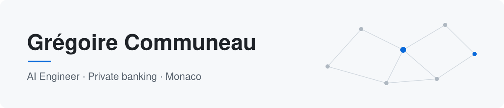

<picture>
  <source media="(prefers-color-scheme: dark)" srcset="assets/banner-dark.svg">
  
</picture>

  

**AI Engineer in private banking, Monaco.** I work in a role created to drive a private bank's move into AI, and I build AI systems that bankers can trust: grounded in real data, traceable to their sources, and deployed where they belong, in the cloud or on-premise.

### What I work on

- **Applied AI**: LLM agents, document understanding and retrieval, with provenance behind every answer, shipped to production alongside business teams.
- **Azure and on-premise**: putting each workload in the right place, from managed cloud services to infrastructure that keeps client data in-house.
- **Security**: [NOPSctf](https://ctf.nops.re), an online CTF that grew to nearly 2,500 participants worldwide. Today, a growing interest in the new forms of attack that AI enables, such as autonomous offensive frameworks like ARTEX, and in how institutions holding sensitive client data can defend against them.
- **Private banking**: tools shaped by the realities of the job, such as client confidentiality, compliance and regulatory scrutiny.

### Background

Engineer from EURECOM (Data Science & AI), with an exchange in Data Science and Finance at the University of Sydney.

---

### Contact

[LinkedIn](https://www.linkedin.com/in/gr%C3%A9goire-communeau-342358287/)
